# MPro 0.1.0 — Foundation & app shell

**Status: released** · Tag `v0.1.0` · Checklist milestone 0.1.0 · Started and finished 2026-10-21

The skeleton everything else hangs on: Flask API, database schema, sign-in, organizations and roles, the
MaintainX-style app shell, design tokens, audit log, background jobs, and the release pipeline with
one-file Windows and Linux test builds.

## Task list

### Checklist items

- [x] **MP-001** Flask app factory, blueprints and config — APIFlask app factory, one package per module, `.env`-driven settings, OpenAPI docs at `/api/docs`
- [x] **MP-002** Database schema v1 — UUIDv7 keys, `org_id` on tenant tables, soft deletes, UTC timestamps; Alembic migrations; tests pass on **SQLite and PostgreSQL 16**
- [x] **MP-003** Docker image and docker-compose — multi-stage image (web build + Python), compose with PostgreSQL, `/healthz`, non-root user
  - Note: no Redis, by design (guideline G-02: self-hosted stays simple). HTTPS via Caddy is part of the 1.0.0 installer.
- [x] **MP-004** Background job worker — database-backed queue (`SKIP LOCKED` on PostgreSQL), retries with back-off, periodic scheduler, admin view with retry
  - Note: built on the database instead of Celery/RQ, so self-hosted needs no extra services.
- [x] **MP-005** Sign in, sign out, password reset — argon2 hashing, "Keep me signed in", rate-limited sign-in, single-use reset links, invitations that set a password
- [x] **MP-006** Organizations and tenant isolation — every query scoped by `org_id`, cross-organization access tests, organization switcher
- [x] **MP-007** MaintainX-style app shell — grouped left navigation (Work / Optimize / Manage), top bar with search and Create, list + detail split, `/` and `Ctrl K` open search
  - Note: the `c` shortcut for "create" comes with work orders in 0.2.0, when there's something to create.
- [x] **MP-008** Design tokens and component library — buttons, fields, status pills (Open / On Hold / In Progress / Done), priority badges, avatars, modals, menus, toasts, skeletons; light and dark themes; live gallery in Settings → Design system
- [ ] **MP-009** Global search across every module — **partly done**: one search endpoint and palette that every module plugs into; people, teams and pages are searchable now
  - Remaining: work orders, assets, parts, locations and procedures register their search as those modules land (0.2.0–0.5.0); PostgreSQL full-text indexes come with those larger tables.
- [x] **MP-010** Responsive layout — works at 375 px wide, bottom navigation on phones, drawer menu, 44 px tap targets
- [x] **MP-011** Audit log of every change — who, what, when, old → new values; filters, search, paging, CSV export

### Roadmap items for this phase

- [x] Scale-ready data rules (UUIDv7, `org_id`, UTC, no local state, idempotent job generation pattern)
- [x] Two editions from one codebase (`MPRO_EDITION`), entitlements service (`can_use` / `limit`)
- [x] Self-hosted runtime without Redis
- [x] Central permission engine with MaintainX roles (Administrator, Limited Administrator, Technician, Requester, View-only)
- [x] Domain events + outbox (the audit log reads from it)
- [x] API-first: the web app uses the public `/api/v1`
- [x] Developer bootstrap: `./start.sh --dev` (and `./start.sh` / `--demo`)
- [x] Testing and CI: pytest (47 tests, SQLite + PostgreSQL), Playwright browser tests (5), ruff, mypy, dependency audit, Docker build
- [x] Release process: tag `vX.Y.Z` → GitHub release with `.exe` and `.AppImage` test builds
- [x] MPro brand: hex-nut logo, favicon, app icons, README banner
- [ ] **Licence choice — needs your decision** (AGPL-3.0, BSL or proprietary). Until then the README says all rights reserved.

### Quality gates

- [x] Backend: 47 tests pass on SQLite and PostgreSQL 16; ruff and mypy clean
- [x] Browser tests: sign-in, wrong password, search palette, create team → audit log, unbuilt module page
- [x] Dependency audit: **0 known vulnerabilities** (pip-audit, npm audit). React Router upgraded to 7.18.4 and Vite to 6.4.4 to clear advisories.
- [x] Bug sweep with screenshots (desktop, dark theme, phone). Fixed: sidebar label overflow, list padding on Overview, sidebar height at 900 px.
- [x] Test build checked locally: the bundled server starts, migrates, loads demo data and serves the app

## Screenshots

| | |
|---|---|
| 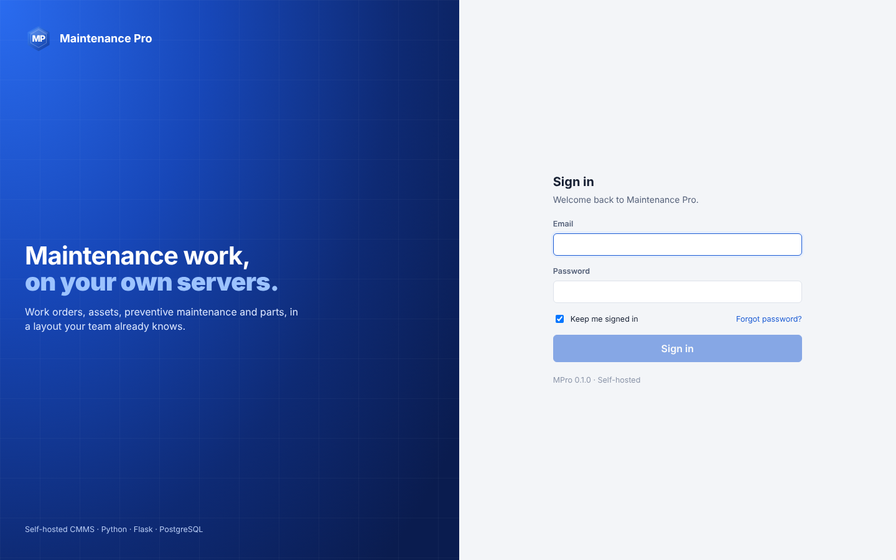 **Sign in** | 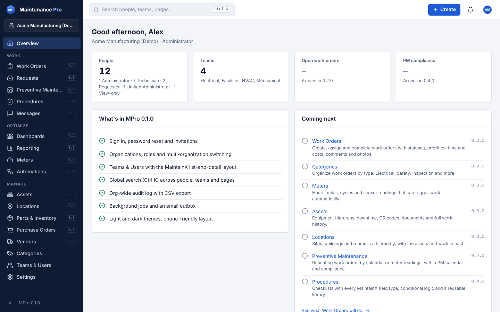 **Overview** |
|  **Teams & Users** (list + detail) | 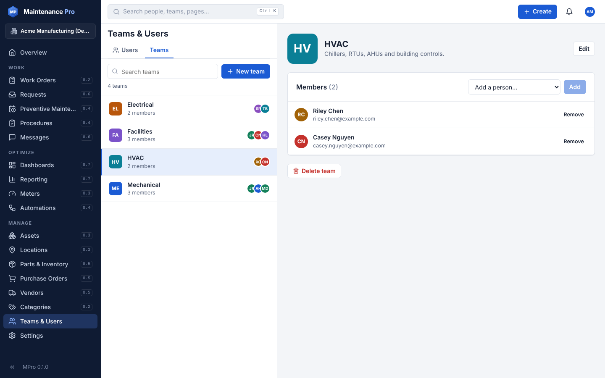 **Team detail** |
| 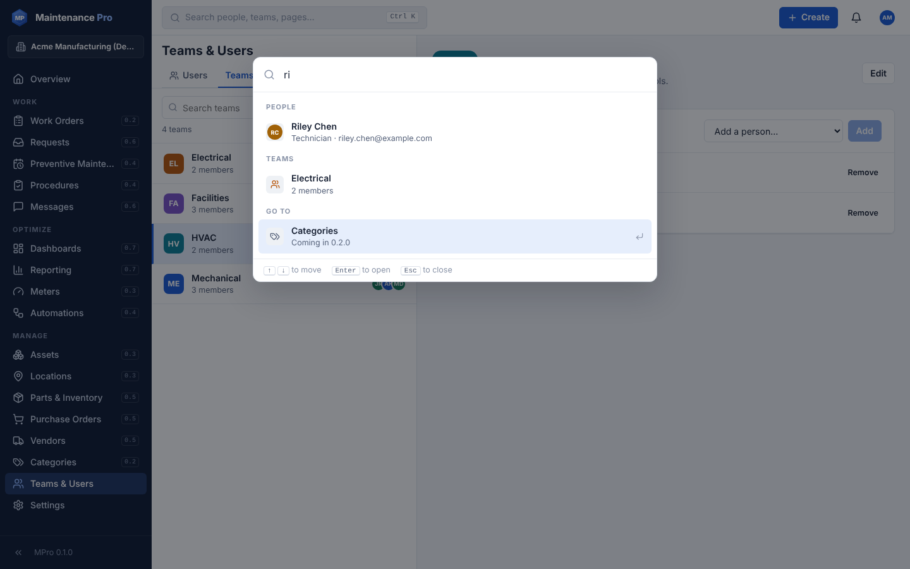 **Global search (Ctrl K)** | 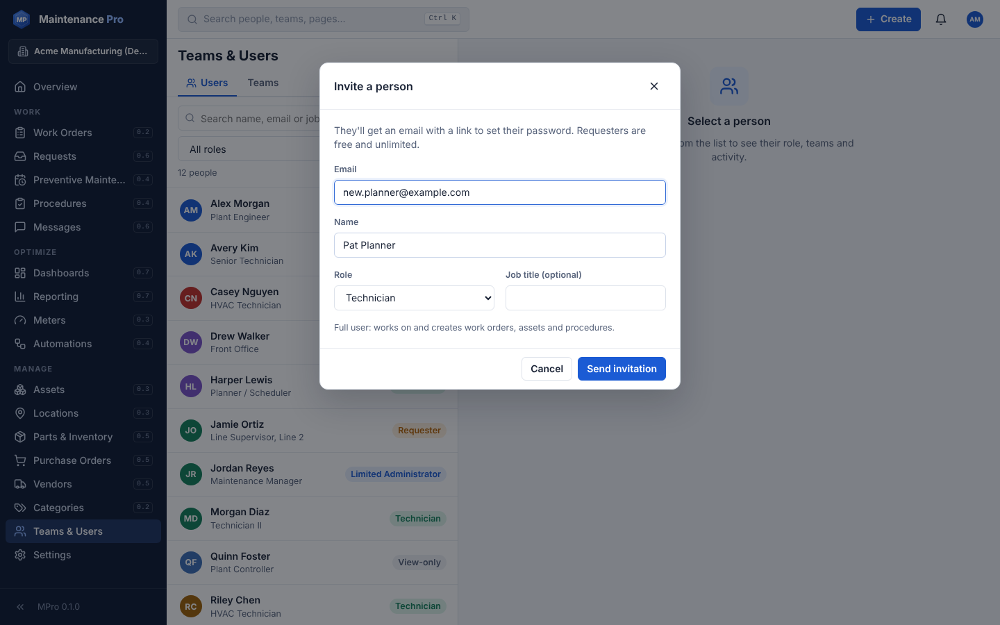 **Invite a person** |
| 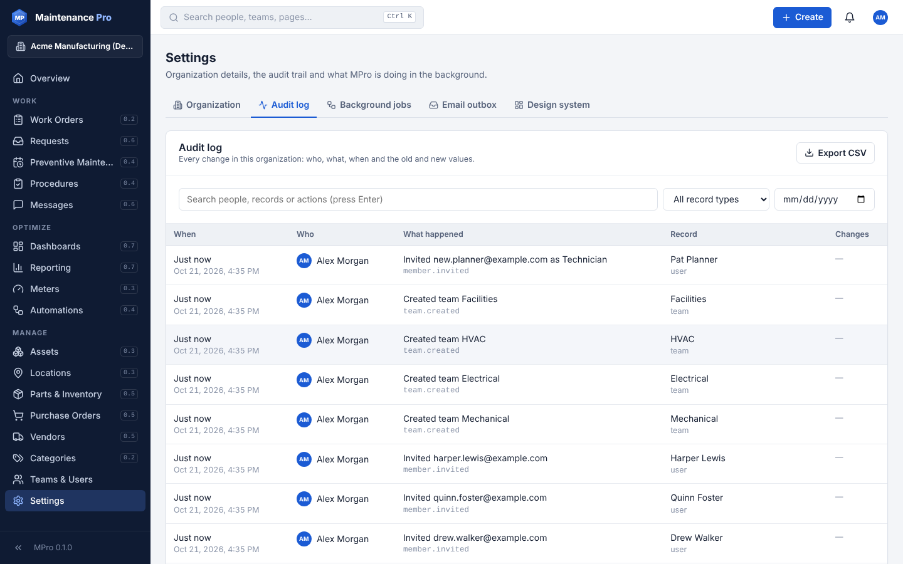 **Audit log** | 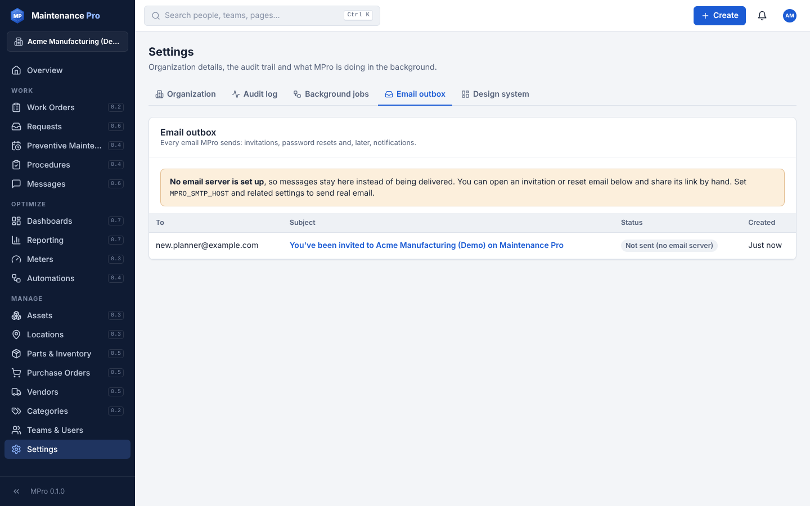 **Email outbox** |
| 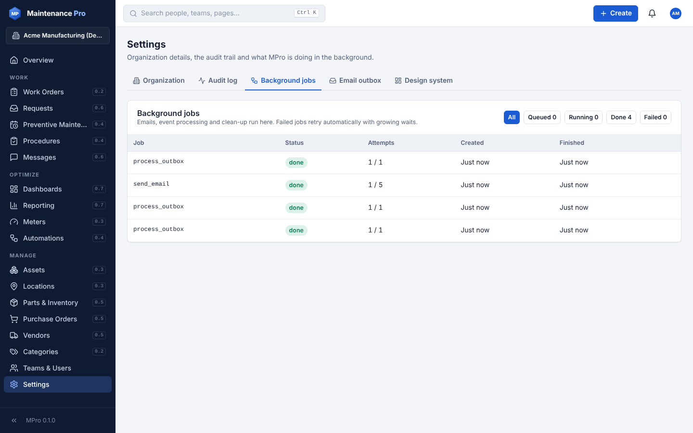 **Background jobs** | 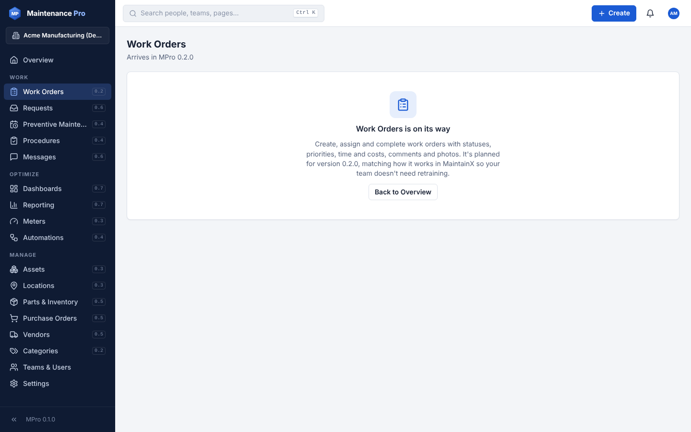 **Modules arriving later** |
| 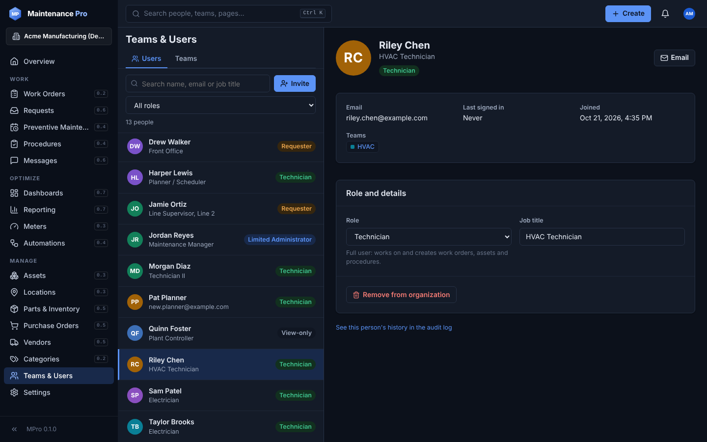 **Dark theme** | 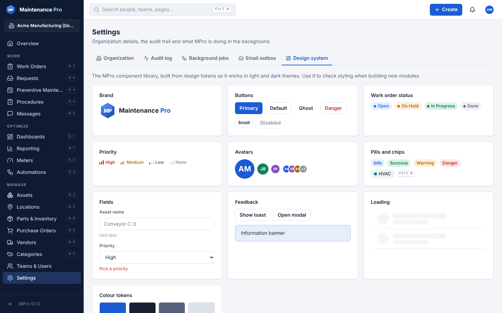 **Design system** |

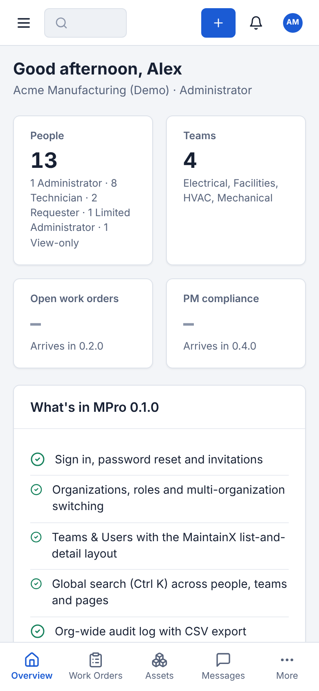
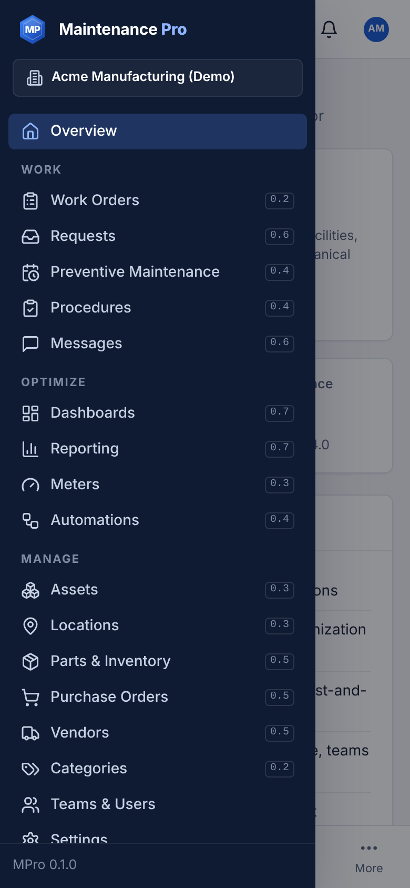
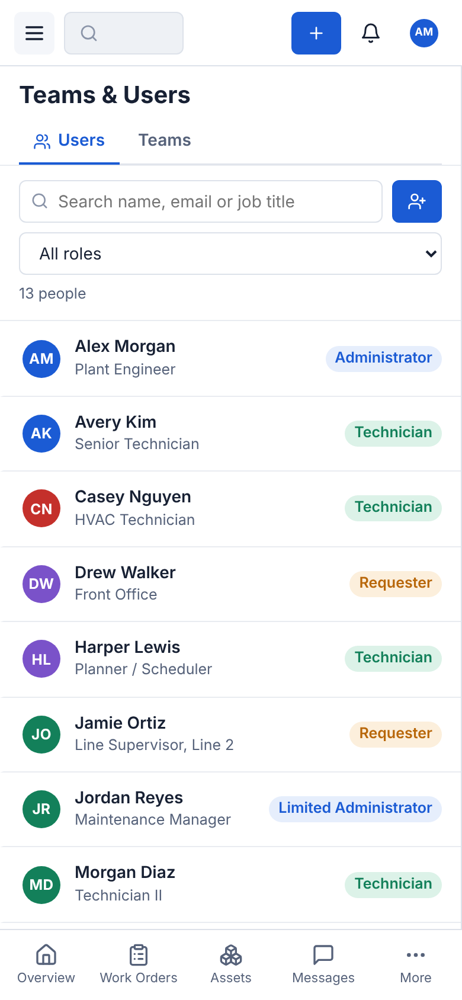

## Known limitations

- Work orders, assets, parts and the other modules show an "arrives in" page until their version ships.
- Without SMTP settings, emails (invitations, resets) stay in Settings → Email outbox.
- The Windows `.exe` isn't code-signed yet, so Windows SmartScreen asks for confirmation the first time.

## Next: 0.2.0 Work orders
